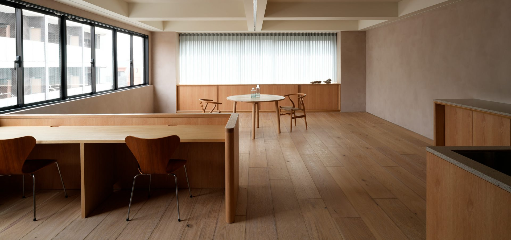
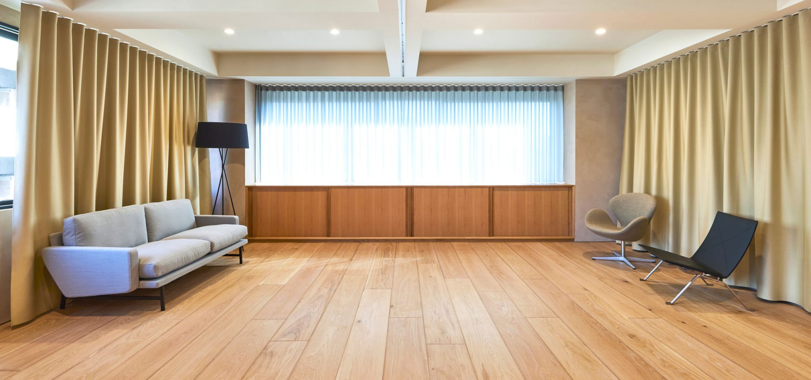
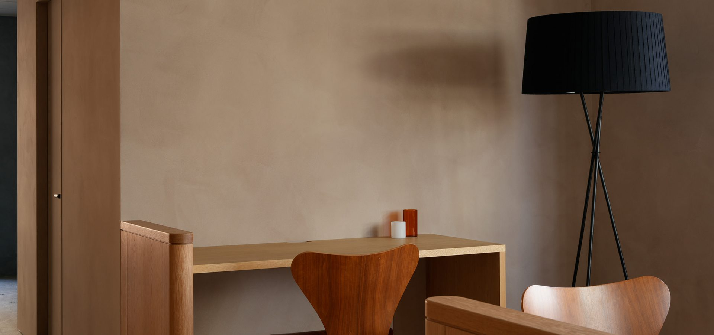
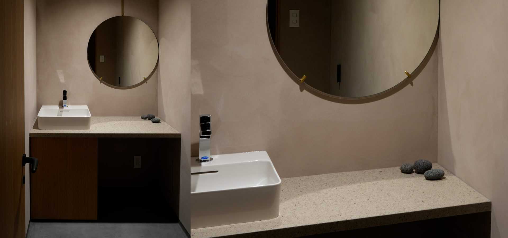
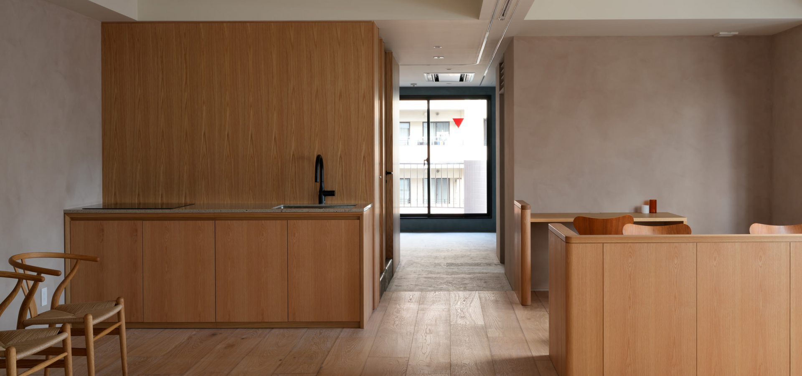

# 【対談・インタビュー撮影】東京・神楽坂で取材撮影をするなら。自然光と北欧家具のハウススタジオ「ARIGATO Living」

<!--
公開予定日: 2026-10-28（火）
狙うクエリ: q8「対談 撮影 スタジオ 東京」/ q9「インタビュー撮影 スタジオ 都内」/ q10「取材や対談の撮影ができる都内のスタジオを教えてください」
素材: 8/19公開の対談記事（公開済み事実）＋ 公式サイト・R-Studio掲載ページの確定情報のみ
-->

雑誌やWebメディアの対談、経営者インタビュー、YouTubeやX向けの収録。
最近、こうした「人を撮る」ご依頼が増えています。

東京・神楽坂のハウススタジオ「ARIGATO Living」は、白ホリや会議室ではなく、**自然光の入るリビング空間で取材・対談を収録できる撮影スタジオ**です。この記事では、実際の対談撮影の事例と、取材撮影にこの空間が向いている理由をまとめます。

## 実例：国山ハセン × 星友啓「AIは教育をどう変えるのか」

2026年8月、当スタジオで対談撮影が行われました。

登壇されたのは、元TBSアナウンサーの国山ハセンさんと、スタンフォードオンラインハイスクール校長の星友啓さん。テーマは「AIは教育をどう変えるのか」。AI時代に求められる学びの形、親や教育者が今できること、オンライン教育とAIがひらく可能性について語られています。

対談の様子は国山ハセンさんの公式Xアカウントで公開されています。

👉 対談の内容は[こちらの記事](https://note.com/casokdo_note/n/n884543ca6477)で詳しく紹介しています。

## 取材・対談の撮影に向いている3つの理由

### 1. 2面の窓から自然光が入る

東面と南面に大きな窓があり、建物の6階で周囲に視界を遮るものが少ないため、日中は自然光だけでも十分に撮影できます。

対談やインタビューでは、照明を組むほど被写体の表情が硬くなることがあります。自然光でやわらかく回る環境は、**話し手の表情をそのまま残したい取材**と相性がいいと考えています。カーテンを引けば光量を落とすこともできるので、時間帯に合わせて調整できます。

### 2. 「生活のある空間」が絵として成立する

床は無垢材、家具は北欧ブランド「フリッツ・ハンセン」のソファ・ダイニングテーブル・チェア。壁はスモーキーカラーの左官仕上げです。

対談は構図のバリエーションが限られる撮影です。
- ソファで向かい合う2名の対談
- ダイニングテーブルを囲む座談会
- カウンター越しのインタビュー
- 窓際でのポートレート

同じ空間のまま、**絵柄を変えられる**のが取材撮影では効いてきます。家具・備品は無料でお使いいただけます。

### 3. 収録の段取りがそのまま完結する

- 撮影用カメラ2台、三脚、配信機材、オペレーター用モニター2台、HDMIケーブル（10m / 5m / 2m）を無料で貸し出し
- LEDライト、レフ板、ライトスタンド、背景紙、白黒カポックも常備
- メイクルーム（洗面台・ハンガーラック2本）あり
- Wi-Fi完備
- 仕切りカーテンで、控えスペースと撮影スペースを分けられる

登壇者が複数いる取材では、**待機・ヘアメイク・収録を1フロアで回せる**かどうかで当日の進行が変わります。同じビルの7階にあるスタジオと同時に利用すれば、合計約170㎡として使うこともできます。

## スタジオ基本情報

| 項目 | 内容 |
|---|---|
| 名称 | ARIGATO Living 神楽坂 |
| 所在地 | 東京都新宿区東榎町4-2 神楽坂グリーンランドビル6F |
| アクセス | 東京メトロ東西線「神楽坂」駅より徒歩6分 |
| 広さ | 89.6㎡（7階スタジオとの同時利用で合計約170㎡） |
| 天井高 | 最大2,680mm |
| 設備 | カウンターキッチン（IH）、メイクルーム、レストルーム、Wi-Fi、仕切りカーテン |
| 備品 | フリッツ・ハンセンの家具、撮影・配信機材、照明一式（無料） |
| 搬入 | エレベーターあり（間口 約W800×H2,100mm） |
| 料金 | 15,000円（税別）/ 1時間、最低利用2時間（搬入から撤収まで） |
| 営業時間 | 10:00〜18:00（時間外・休日は20%増、応相談） |
| 用途 | 対談・座談会・インタビュー、スチール／ムービー撮影、動画配信、商品撮影、展示会、セミナー |
| 駐車場 | なし（近隣コインパーキングをご利用ください） |

## 撮影のご相談・仮予約

ロケハン、仮予約、撮影内容のご相談を受け付けています。
カメラマンや動画編集者のご紹介、プレスリリースの制作・配信までお手伝いできます。

- 公式サイト：https://www.a-ms2.com/arigatoliving/studio/kagurazaka/
- お電話：03-3528-9716（平日10:00〜18:00）

取材・対談の撮影場所をお探しの方は、お気軽にご連絡ください。
