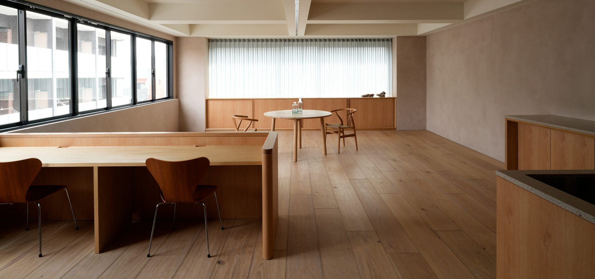
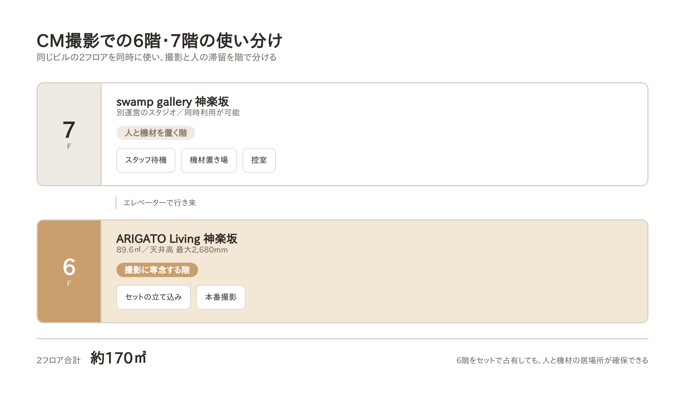
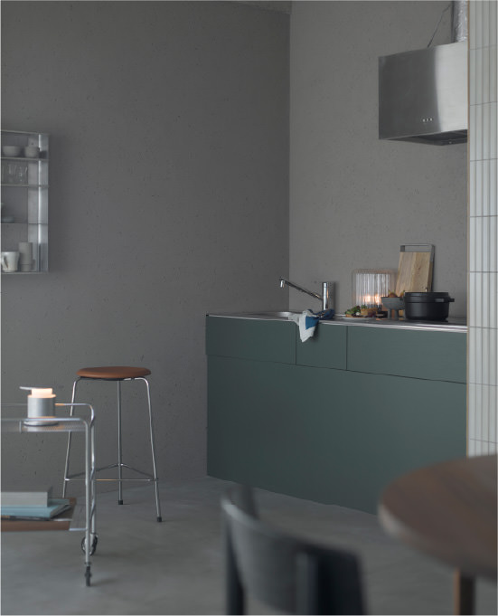
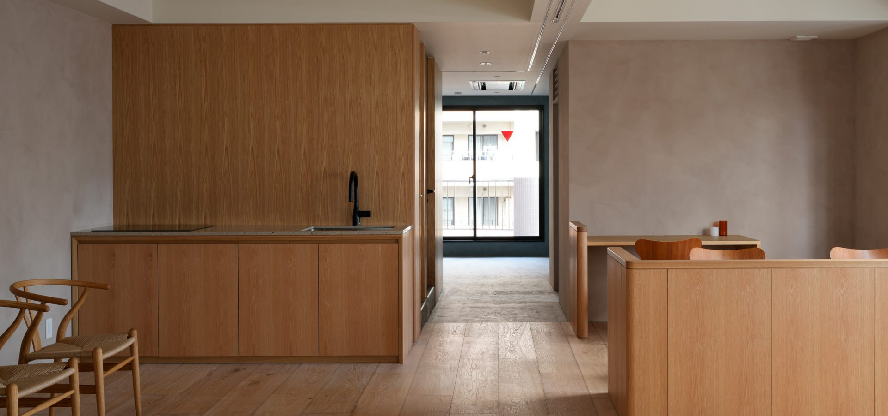

# 【2フロア同時利用】神楽坂の撮影スタジオを約170㎡で使う。セット撮影から控室まで、ハウススタジオ「ARIGATO Living」

<!--
公開予定日: 2026-11-03（火）
狙うクエリ: q2「神楽坂 撮影スタジオ」/ q3「神楽坂 スタジオ」/ q1「神楽坂 ハウススタジオ」
  → AIモードで4週連続 × が続いている最重要クエリ群
素材:
  - CM撮影の実例 … content/note/FACTS.md（運営者に確認済みの範囲のみ）
  - 面積・料金・設備 … 公式サイト / R-Studio掲載ページ
  - 広告主名・人数・セットの詳細は未確認のため書かない
-->

CM、ブランドムービー、発表会。人数の多い撮影では、スタジオの広さそのものより**「撮影する場所」と「人が待つ場所」を分けられるか**で当日の進行が決まります。

東京・神楽坂のハウススタジオ「ARIGATO Living」は、同じビルの7階にあるスタジオと同時に利用でき、合わせて**約170㎡**になります。この記事では、実際のテレビCM撮影で2つのフロアをどう使い分けたかを紹介します。

## 実例：テレビCMの撮影で、2フロアを2日間

テレビCMの撮影で、6階と7階を同時に利用しました。期間は**2日間**です。

撮影したのは、椅子とテーブルを使った**ダイニングのシーン**。6階はフロア全体にセットを立て込み、作り込んだ空間で本番撮影に専念しました。

CM撮影は関係者が多く、6階だけでは人数が入りきりません。そこで7階を、スタッフの待機所、機材置き場、そして控室として使いました。

## 階で役割を分けると、何が変わるか

### 1. フロアをまるごとセットに使える

6階をセットで占有すると、通常なら待機スペースも荷物置き場も無くなります。別フロアがあることで、**6階を撮影のためだけに使い切れます。**

広さは89.6㎡、天井高は最大2,680mm。搬入はエレベーターで、間口は約W800×H2,100mmです。

なお、セットの立て込みは内容によって可否や条件が変わります。事前にご相談ください。

### 2. 人の滞留を、撮影から切り離せる

7階は同じビルにある別運営のスタジオで、控室としての利用ができます。スタッフの待機、機材の仮置き、着替えやヘアメイクを、撮影しているフロアの外に出せます。

カメラが回っている横を人が通らない。それだけで撮影のテンポは変わります。

### 3. 複数日の撮影でも、組み直さずに済む

今回は2日間の撮影でした。セットを組んでから撤収するまでフロアを押さえられるので、**毎日セットを建て直す必要がありません。**

初日に作り込んだ状態のまま翌日に入れることは、カット数の多い撮影では段取りそのものを変えます。

## 2フロア同時利用の料金

| 項目 | 内容 |
|---|---|
| スチール撮影 | 29,700円 / 時 |
| ムービー撮影 | 33,000円 / 時 |
| 最低利用時間 | 3時間 |
| 2フロア合計 | 約170㎡ |

掲載時点の料金です。日数単位でのご利用や時間外については、お問い合わせください。

## スタジオ基本情報

| 項目 | 内容 |
|---|---|
| 名称 | ARIGATO Living 神楽坂 |
| 所在地 | 東京都新宿区東榎町4-2 神楽坂グリーンランドビル6F |
| アクセス | 東京メトロ東西線「神楽坂」駅より徒歩6分 |
| 広さ | 89.6㎡（7階スタジオとの同時利用で合計約170㎡） |
| 天井高 | 最大2,680mm |
| 搬入 | エレベーターあり（間口 約W800×H2,100mm） |
| 電気容量 | 70A |
| 設備 | カウンターキッチン（IH）、メイクルーム、レストルーム、Wi-Fi、仕切りカーテン |
| 備品 | フリッツ・ハンセンの家具、撮影・配信機材、照明一式（無料） |
| 6階のみの料金 | 15,000円（税別）/ 1時間、最低利用2時間（搬入から撤収まで） |
| 営業時間 | 10:00〜18:00（時間外・休日は20%増、応相談） |
| 用途 | スチール／ムービー撮影、対談・座談会・インタビュー、動画配信、商品撮影、展示会、セミナー |
| 駐車場 | なし（近隣コインパーキングをご利用ください） |

## 撮影のご相談・仮予約

ロケハン、仮予約、撮影内容のご相談を受け付けています。
カメラマンや動画編集者のご紹介、プレスリリースの制作・配信までお手伝いできます。

- 公式サイト：https://www.a-ms2.com/arigatoliving/studio/kagurazaka/
- お電話：03-3528-9716（平日10:00〜18:00）

人数の多い撮影や、セットを組む撮影をご検討の方は、お気軽にご相談ください。
