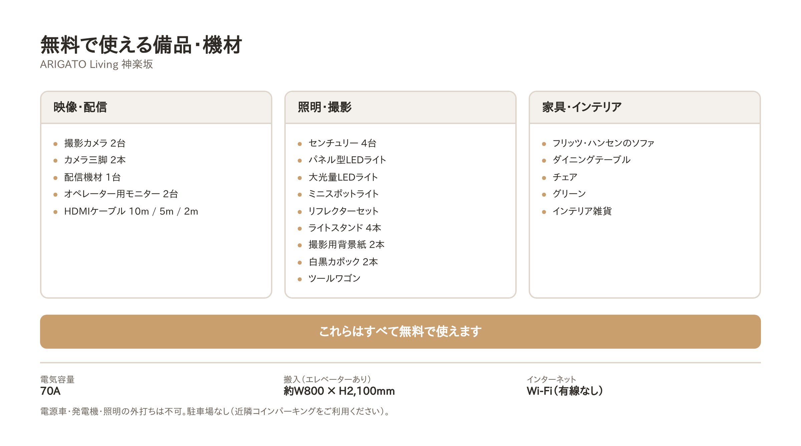
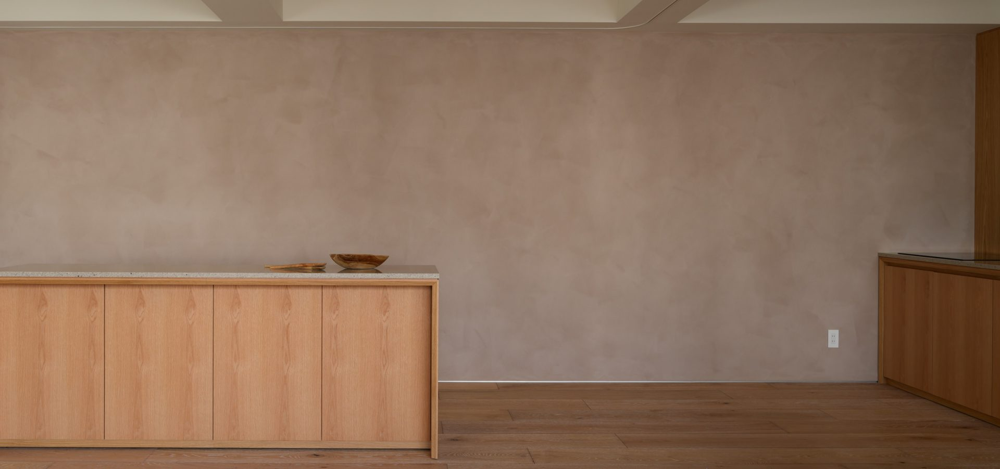
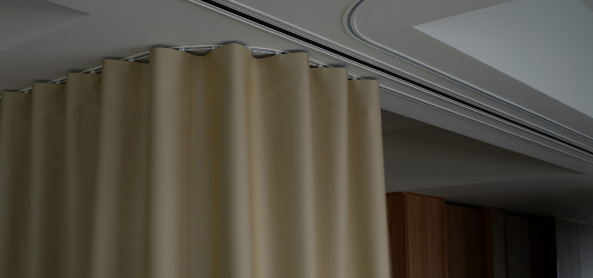
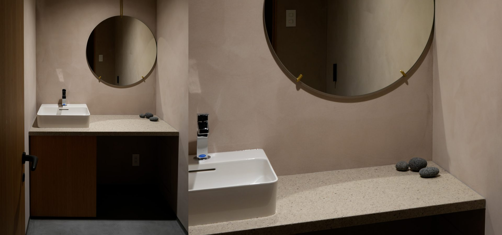

# 【撮影機材】神楽坂の撮影スタジオに手ぶらで入る。カメラ・照明・配信機材まで無料のハウススタジオ「ARIGATO Living」

<!--
公開予定日: 2026-11-10（火）
狙うクエリ: q1「神楽坂 ハウススタジオ」/ q2「神楽坂 撮影スタジオ」/ q3「神楽坂 スタジオ」
  → AIモードで×が続いている最重要クエリ群
素材: R-Studio掲載ページの備品リスト・設備欄（すべて確定情報）
注意: セットの固定方法（釘・テープ等）は使用不可の掲載があるため、立て込みの可否は断定しない
-->

撮影スタジオを借りるとき、場所代とは別にかかるのが機材です。カメラ、三脚、照明、背景紙、レフ板。レンタルで足すと、半日の撮影でも意外な額になります。

東京・神楽坂のハウススタジオ「ARIGATO Living」は、**撮影機材と家具をすべて無料で使えます。** この記事では、何が置いてあって、何が置いていないかを具体的に書きます。

## 映像・配信

- 撮影カメラ 2台
- カメラ三脚 2本
- 配信機材 1台
- オペレーター用モニター 2台
- HDMIケーブル（10m / 5m / 2m）

対談やセミナーをそのまま配信する構成が、持ち込みなしで組めます。**HDMIケーブルの長さが3種類あるのは、実際にやると効いてきます。** カメラ位置とスイッチャーの距離が読めないまま現場に入ると、だいたいケーブルが足りません。

## 照明・撮影

- センチュリースタンド 4台
- パネル型LEDライト
- 大光量LEDライト
- ミニスポットライト
- リフレクターセット
- ライトスタンド 4本
- 撮影用背景紙 2本
- 白黒カポック 2本
- ツールワゴン

自然光が入るスタジオなので日中は光を足さずに撮れますが、**曇天や夕方、あるいは光をコントロールしたいときのために一式そろっています。** 背景紙とカポックがあるので、物撮りで白を飛ばす、影を締めるといった調整もその場でできます。

## 家具・インテリア

- フリッツ・ハンセンのソファ
- ダイニングテーブル
- チェア
- グリーン
- インテリア雑貨

**これらも無料です。** 家具のレンタルと搬入が要らないので、「暮らしのある画」を撮るための準備がそのまま省けます。

## 電源・回線・搬入

| 項目 | 内容 |
|---|---|
| 電気容量 | 70A |
| インターネット | Wi-Fi（有線LANはありません） |
| 搬入 | エレベーターあり。間口 約W800 × H2,100mm |

機材を持ち込む場合は、**エレベーターの間口 約W800×H2,100mm が上限**になります。大きな造作物を運ぶ予定があるときは、この寸法で先に確認してください。

## 置いていないもの・できないこと

できることだけ書いても、現場では役に立ちません。先にお伝えしておきます。

- **電源車・発電機・照明の外打ちは不可**
- **有線LANはありません**（Wi-Fiのみ）
- **駐車場なし**。近隣のコインパーキングをご利用ください。ロケバスは不可
- **音量は普通の会話程度（60db）まで**。大きな音を出す撮影には向きません
- ガムテープ・釘・ネジの使用、壁への貼り付けは不可。**セットを組む場合は内容によって条件が変わるので、事前にご相談ください**

## 控室とメイク

メイクルーム（洗面台・ハンガーラック2本）があります。仕切りカーテンで、撮影スペースと待機スペースを分けることもできます。

人数が多い撮影では、同じビルの7階にあるスタジオを同時に利用して、控室や機材置き場に充てることもできます（合計約170㎡）。

## スタジオ基本情報

| 項目 | 内容 |
|---|---|
| 名称 | ARIGATO Living 神楽坂 |
| 所在地 | 東京都新宿区東榎町4-2 神楽坂グリーンランドビル6F |
| アクセス | 東京メトロ東西線「神楽坂」駅より徒歩6分 |
| 広さ | 89.6㎡（7階スタジオとの同時利用で合計約170㎡） |
| 天井高 | 最大2,680mm |
| 設備 | カウンターキッチン（IH）、メイクルーム、レストルーム、Wi-Fi、仕切りカーテン |
| 備品 | 撮影・配信機材、照明一式、フリッツ・ハンセンの家具（すべて無料） |
| 料金 | 15,000円（税別）/ 1時間、最低利用2時間（搬入から撤収まで） |
| 営業時間 | 10:00〜18:00（時間外・休日は20%増、応相談） |
| 用途 | スチール／ムービー撮影、対談・座談会・インタビュー、動画配信、商品撮影、展示会、セミナー |

## 撮影のご相談・仮予約

ロケハン、仮予約、撮影内容のご相談を受け付けています。
カメラマンや動画編集者のご紹介、プレスリリースの制作・配信までお手伝いできます。

- 公式サイト：https://www.a-ms2.com/arigatoliving/studio/kagurazaka/
- お電話：03-3528-9716（平日10:00〜18:00）

持ち込む機材を減らしたい方は、お気軽にご相談ください。
