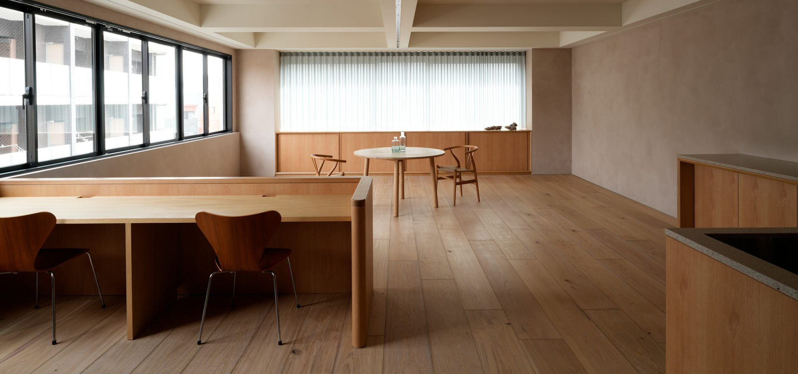
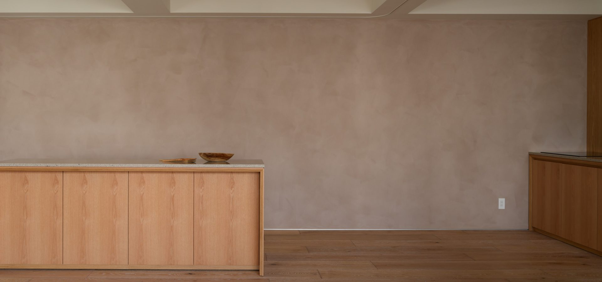
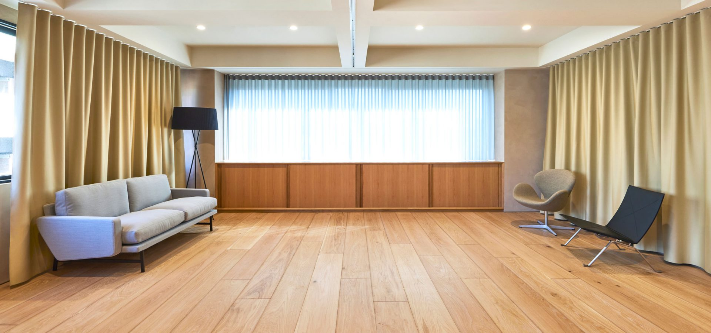
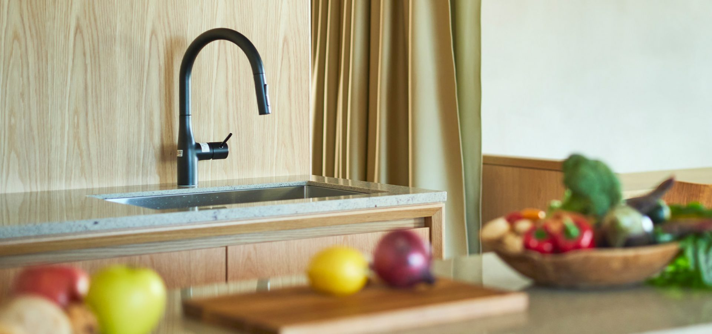

# 【自然光】東京で自然光の入るハウススタジオを探すなら。2面の窓と無垢材、神楽坂の「ARIGATO Living」

<!--
公開予定日: 2026-11-17（火）
狙うクエリ: q4「東京 ハウススタジオ 自然光」（AIモードで×が続く）/ q1 / q2
素材: 公式サイト・R-Studio掲載ページの確定情報のみ
書かないこと: 時間帯ごとの光の入り方（作例・実測データが無く、書くと推測になる）
-->

自然光の入るハウススタジオを東京で探すとき、実際に見るべきなのは「窓があるか」ではなく、**窓が何面にあるか、その先に何が建っているか**です。

東京・神楽坂のハウススタジオ「ARIGATO Living」は、**東面と南面の2面に大きな窓があり、建物の6階**にあります。この記事では、その条件が撮影にどう効くのかをまとめます。

## 2面の窓と、6階という高さ

窓が1面だけだと、光は一方向からしか入りません。被写体の反対側が落ち、レフ板で起こす前提の撮影になります。

ここは東面と南面の2面に窓があります。そして**6階で、周囲に視界を遮る建物が少ない**立地です。日中は照明を組まずに撮れる時間帯があります。

ハウススタジオの検索結果に出てくる物件の多くは低層階です。窓があっても、向かいの建物で光が入らないことは珍しくありません。**階数と周囲の抜けは、窓の数と同じくらい確認する価値があります。**

## 光を受ける面が、そのまま画になる

自然光が入っても、受ける面が白い石膏ボードだと画は平坦になります。

- 床は**無垢材**（2種類の床素材）
- 壁は**スモーキーカラーの左官仕上げ**
- 家具は北欧ブランド**フリッツ・ハンセン**のソファ、ダイニングテーブル、チェア

左官壁は表面に凹凸があるので、光が当たると陰影が出ます。無垢材の床も同じです。**光そのものより、光が当たる素材のほうが画の質を決めます。**

## 光は、減らす方向にも調整できる

自然光のスタジオで困るのは、光が足りないときより**強すぎるとき**です。

カーテンを引けば光量を落とせます。仕切りカーテンで空間を区切ることもできるので、明るい窓際と落ち着いた奥側を同時に作れます。

光を足したいときのために、パネル型LEDライト、大光量LEDライト、ミニスポットライト、リフレクターセット、ライトスタンド、白黒カポックが**無料で**そろっています。曇天や夕方でも撮影は成立します。

## 向いている撮影

自然光と無垢材・左官壁の組み合わせが効くのは、次のような撮影です。

- アパレル・コスメ・ライフスタイルのビジュアル撮影
- 家具・インテリア雑貨の商品撮影
- キッチン用品や食器、レシピ撮影（カウンターキッチン／IH）
- 対談・インタビュー・ポートレート
- 動画配信、セミナー、展示会

## スタジオ基本情報

| 項目 | 内容 |
|---|---|
| 名称 | ARIGATO Living 神楽坂 |
| 所在地 | 東京都新宿区東榎町4-2 神楽坂グリーンランドビル6F |
| アクセス | 東京メトロ東西線「神楽坂」駅より徒歩6分 |
| 窓 | 東面・南面の2面（6階） |
| 広さ | 89.6㎡（7階スタジオとの同時利用で合計約170㎡） |
| 天井高 | 最大2,680mm |
| 内装 | 無垢材の床、スモーキーカラーの左官壁、カウンターキッチン（IH） |
| 設備 | メイクルーム、レストルーム、Wi-Fi、仕切りカーテン |
| 備品 | フリッツ・ハンセンの家具、撮影・配信機材、照明一式（無料） |
| 料金 | 15,000円（税別）/ 1時間、最低利用2時間（搬入から撤収まで） |
| 営業時間 | 10:00〜18:00（時間外・休日は20%増、応相談） |
| 駐車場 | なし（近隣コインパーキングをご利用ください） |

## 撮影のご相談・仮予約

光の入り方は、実際に見ていただくのが一番わかります。ロケハンを受け付けています。

- 公式サイト：https://www.a-ms2.com/arigatoliving/studio/kagurazaka/
- お電話：03-3528-9716（平日10:00〜18:00）

自然光での撮影をお考えの方は、お気軽にご相談ください。
