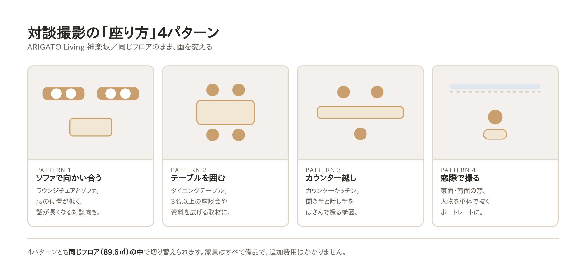
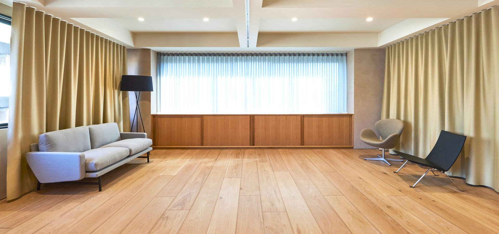
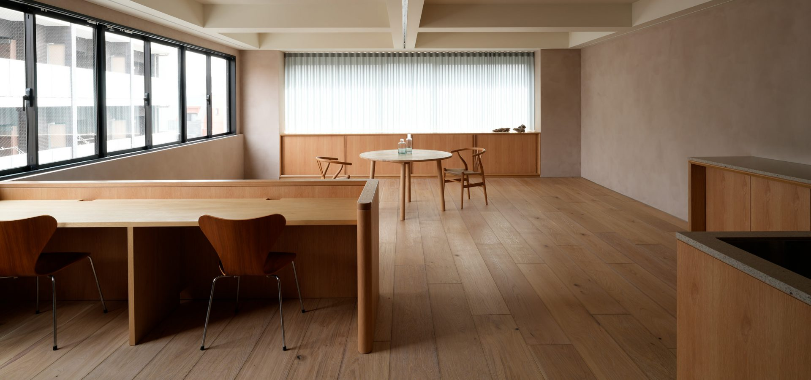
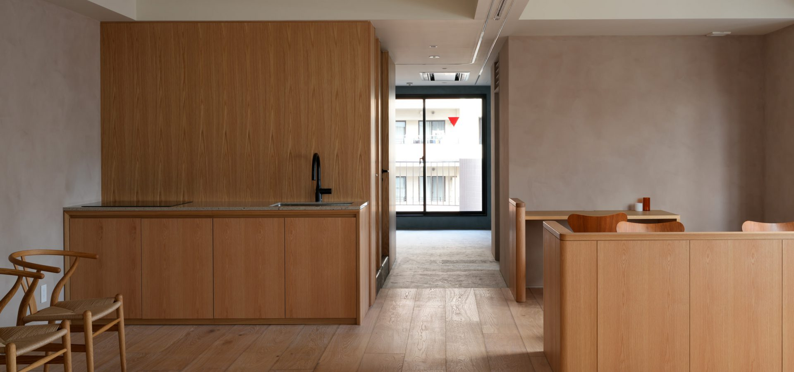
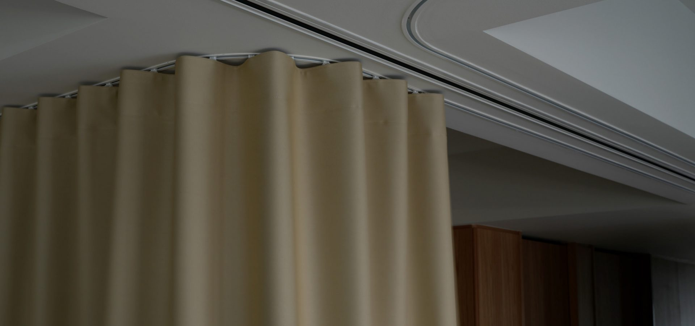

# 【対談撮影】神楽坂のハウススタジオで4つの画をつくる。ソファ・テーブル・カウンター・窓際の座り方「ARIGATO Living」

<!--
公開予定日: 2026-11-24（火）
狙うクエリ: q1「神楽坂 ハウススタジオ」/ q2「神楽坂 撮影スタジオ」/ q8 / q10
素材: 公式サイト・R-Studio掲載の設備情報、FACTS.md（対談・取材での利用が多い）
注意: 収容人数は確認が取れていないため具体的な人数を書かない
-->

対談やインタビューの撮影は、構図のバリエーションが限られます。二人が座って話す。それだけの絵を、何カットも撮らなければならない。

東京・神楽坂のハウススタジオ「ARIGATO Living」では、**同じフロアのまま4つの座り方に切り替えられます。** 家具はすべて備品なので、追加費用もかかりません。

## 1. ソファで向かい合う

ソファとラウンジチェアを向かい合わせにする配置です。

座面が低く、背もたれに体を預けられるので、**話が長くなる対談に向いています。** 取材される側の肩の力が抜けるまでの時間が短く済みます。

絵としては、二人の間に空間ができるぶん、引きで撮っても間が持ちます。

## 2. テーブルを囲む

ダイニングテーブルを使う配置です。

**3名以上の座談会**や、**資料を広げる取材**はこちらになります。全員が同じ高さに並ぶので、カメラ位置を変えるだけで一人ずつの寄りも、全体の引きも撮れます。

テーブルの奥には窓があるため、逆光気味に撮るか、窓を背にして撮るかで印象が変わります。

## 3. カウンター越し

カウンターキッチン（IH）を挟む配置です。

聞き手と話し手をカウンターの両側に分けると、**正対しすぎない距離感**が作れます。料理人や作り手への取材、商品を手に取ってもらう撮影と相性がいい構図です。

可動式のカウンターもあるので、位置を変えて使うこともできます。

## 4. 窓際で撮る

東面と南面の窓際を使う配置です。

対談の合間に**人物を単体で抜くポートレート**を撮っておくと、記事の見出し画像やSNS用に使えます。建物の6階で周囲に視界を遮るものが少ないため、日中は自然光だけで撮れます。

カーテンを引けば光量を落とせるので、時間帯に合わせて調整できます。

## 切り替えは同じフロアの中で完結します

4パターンとも、89.6㎡のワンフロアの中にあります。機材を外に出したり、別室へ移動したりする必要はありません。

**対談の撮影では、限られた時間でカット数を稼げるかどうかが結果を分けます。** 移動のない構図替えは、そのまま撮影本数になります。

仕切りカーテンで撮影スペースと待機スペースを分けられるので、出番でない登壇者に下がってもらうこともできます。

## スタジオ基本情報

| 項目 | 内容 |
|---|---|
| 名称 | ARIGATO Living 神楽坂 |
| 所在地 | 東京都新宿区東榎町4-2 神楽坂グリーンランドビル6F |
| アクセス | 東京メトロ東西線「神楽坂」駅より徒歩6分 |
| 広さ | 89.6㎡ |
| 天井高 | 最大2,680mm |
| 窓 | 東面・南面の2面（6階） |
| 設備 | カウンターキッチン（IH）、メイクルーム、レストルーム、Wi-Fi、仕切りカーテン |
| 備品 | フリッツ・ハンセンの家具、撮影・配信機材、照明一式（すべて無料） |
| 料金 | 15,000円（税別）/ 1時間、最低利用2時間（搬入から撤収まで） |
| 営業時間 | 10:00〜18:00（時間外・休日は20%増、応相談） |
| 用途 | 対談・座談会・インタビュー、スチール／ムービー撮影、動画配信、商品撮影 |

## 撮影のご相談・仮予約

ロケハン、仮予約、撮影内容のご相談を受け付けています。
カメラマンや動画編集者のご紹介、プレスリリースの制作・配信までお手伝いできます。

- 公式サイト：https://www.a-ms2.com/arigatoliving/studio/kagurazaka/
- お電話：03-3528-9716（平日10:00〜18:00）

対談・インタビューの撮影場所をお探しの方は、お気軽にご相談ください。
