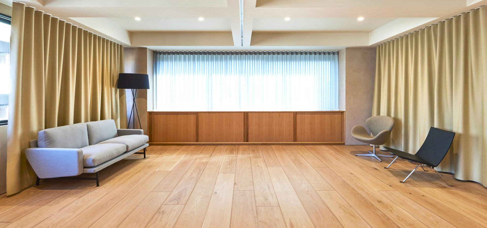
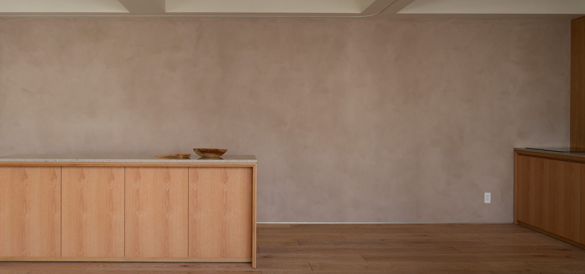
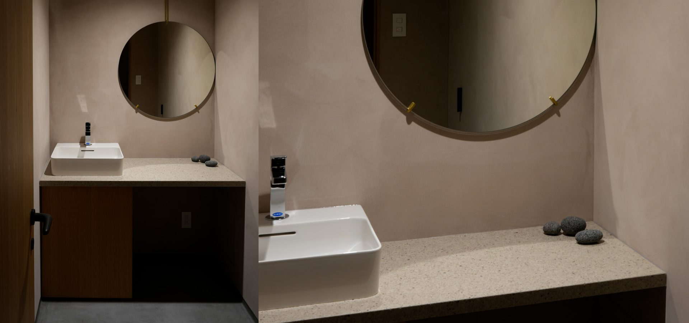

# 【取材撮影】神楽坂の撮影スタジオで、話し手の表情が硬くならない空間を。木目と自然光、ラウンジチェアの「ARIGATO Living」

<!--
公開予定日: 2026-12-01（火）
狙うクエリ: q1「神楽坂 ハウススタジオ」/ q2「神楽坂 撮影スタジオ」/ q9「インタビュー撮影 スタジオ 都内」
素材: FACTS.md（対談・取材での利用が多い、空間の性格）＋ 公式サイト・R-Studio掲載
注意:
  - 「女性に人気」「文化人に人気」と断定しない。理由を具体で書く
  - 7階併用（控室）はメリットとして書かない。支度・待機は6階内で完結させる
  - 家具は種類まで。個別の製品名は書かない
-->

ここ最近、**対談や取材での撮影のご依頼が増えています。**

東京・神楽坂のハウススタジオ「ARIGATO Living」は、もともと「暮らしのある空間」として作ったスタジオです。会議室でも白ホリでもない場所で人を撮りたい、というご相談が重なった結果、取材の現場として使われることが多くなりました。

この記事では、取材・インタビューの撮影で何が効いているのかを、具体的に書きます。

## 座る場所が、話の長さを決める

取材は、話が温まるまでに時間がかかります。最初の10分で出てくる言葉と、30分経ってから出てくる言葉は違います。

ここには**ゆったり座れるラウンジチェアとソファ**があります。座面が低く、背もたれに体を預けられる椅子です。パイプ椅子や会議用チェアで同じ時間を過ごすのとは、話し手の姿勢が変わります。

ダイニングテーブルとチェアもあるので、資料を広げる取材や3名以上の座談会にも対応できます。家具はすべて備品で、**追加費用はかかりません。**

## 照明を組まないという選択

東面と南面の2面に窓があり、建物の6階で周囲に視界を遮るものが少ないため、**日中は照明を組まずに撮れる時間帯があります。**

取材される側にとって、照明を何灯も向けられるのは緊張する状況です。ライトが少ないほど、現場の空気は普通に近づきます。自然光でやわらかく回る環境は、**話し手の表情をそのまま残したい取材**と相性がいいと考えています。

カーテンを引けば光量を落とせます。曇天や夕方のために、パネル型LEDライト、大光量LEDライト、ミニスポットライト、リフレクターセットも無料で使えます。

## 木目と左官壁が、背景として成立する

床は無垢材。壁はスモーキーカラーの左官仕上げです。

白い壁に人を立たせると、背景は情報を持ちません。木目と左官の壁は、**写っているだけでその人の居場所になります。** 書き手の取材記事、経営者のインタビュー、著書の著者近影。どれも「どこで撮ったか」が記事の印象に残ります。

## 支度する場所がある

メイクルームがあります。洗面台とハンガーラック2本を備えた個室です。

登壇者が着替える、ヘアメイクを入れる、撮影前に身支度を整える。**撮影しているフロアの脇でそれをやらずに済みます。**

さらに仕切りカーテンで、撮影スペースと待機スペースを分けられます。出番でない人が画角に入らない位置で待てる、というだけで現場は落ち着きます。

## 実際の対談撮影

元TBSアナウンサーの国山ハセンさんと、スタンフォードオンラインハイスクール校長の星友啓さんの対談が、このスタジオで撮影されました。テーマは「AIは教育をどう変えるのか」です。

対談の様子は国山ハセンさんの公式Xアカウントで公開されています。

👉 対談の内容は[こちらの記事](https://note.com/casokdo_note/n/n884543ca6477)で詳しく紹介しています。

## 駅から徒歩6分

東京メトロ東西線「神楽坂」駅から徒歩6分です。

取材は、登壇者に来ていただく撮影です。**先方の移動の負担が少ないことは、スタジオ選びの条件のひとつになります。** 神楽坂は飯田橋・九段下からも近く、都心の多くの場所から出やすい立地です。

## スタジオ基本情報

| 項目 | 内容 |
|---|---|
| 名称 | ARIGATO Living 神楽坂 |
| 所在地 | 東京都新宿区東榎町4-2 神楽坂グリーンランドビル6F |
| アクセス | 東京メトロ東西線「神楽坂」駅より徒歩6分 |
| 広さ | 89.6㎡ |
| 天井高 | 最大2,680mm |
| 窓 | 東面・南面の2面（6階） |
| 内装 | 無垢材の床、スモーキーカラーの左官壁、カウンターキッチン（IH） |
| 設備 | メイクルーム（洗面台・ハンガーラック2本）、レストルーム、Wi-Fi、仕切りカーテン |
| 備品 | ソファ・ラウンジチェア・ダイニングテーブル・チェア（フリッツ・ハンセン）、撮影・配信機材、照明一式（すべて無料） |
| 料金 | 15,000円（税別）/ 1時間、最低利用2時間（搬入から撤収まで） |
| 営業時間 | 10:00〜18:00（時間外・休日は20%増、応相談） |
| 用途 | 対談・座談会・インタビュー、スチール／ムービー撮影、動画配信、商品撮影 |

## 撮影のご相談・仮予約

ロケハン、仮予約、撮影内容のご相談を受け付けています。
カメラマンや動画編集者のご紹介、プレスリリースの制作・配信までお手伝いできます。

- 公式サイト：https://www.a-ms2.com/arigatoliving/studio/kagurazaka/
- お電話：03-3528-9716（平日10:00〜18:00）

取材・インタビューの撮影場所をお探しの方は、お気軽にご相談ください。
